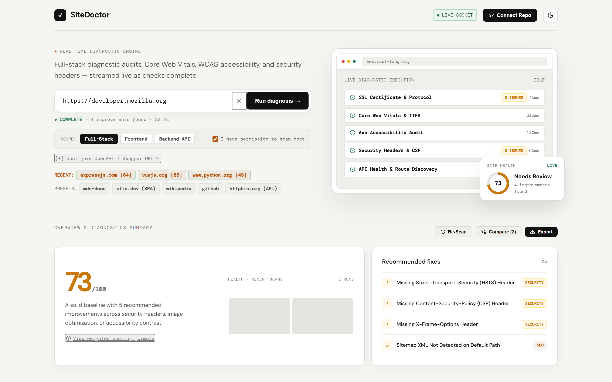
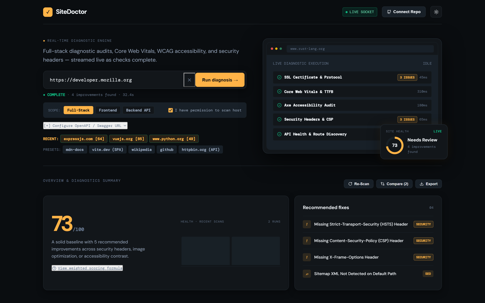
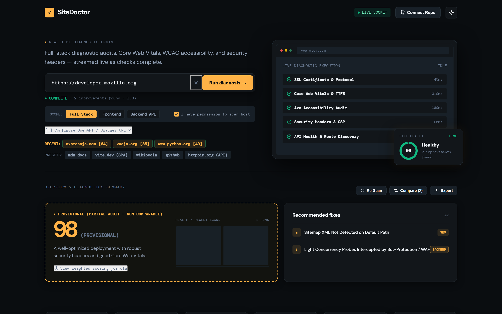
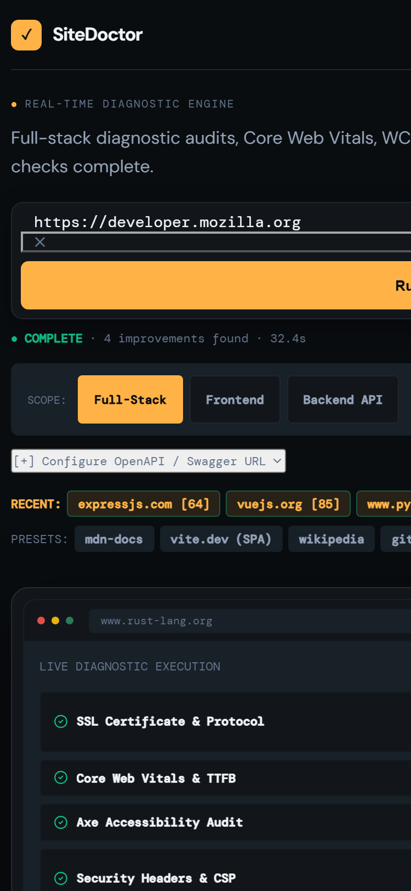
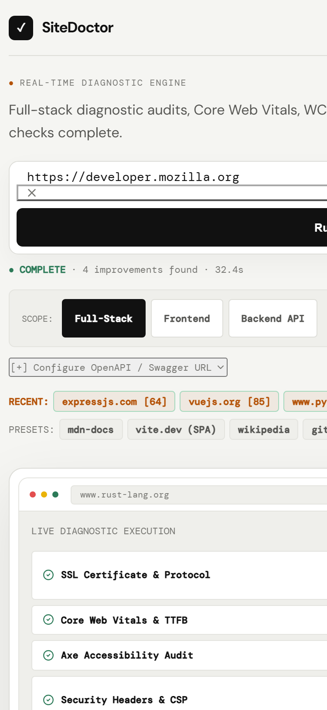

# 🩺 SiteDoctor — Real-Time Full-Stack Diagnostic & Automated Remediation Platform

[](https://www.typescriptlang.org/)
[](https://react.dev/)
[](https://nodejs.org/)
[](https://playwright.dev/)
[](https://socket.io/)
[](LICENSE)

**SiteDoctor** is a full-stack, real-time diagnostic engine and automated remediation platform for websites and backend APIs. It runs comprehensive technical audits—including headless browser execution, Core Web Vitals, WCAG 2.1 AA accessibility, SSL/TLS certificate chains, security headers, and API health—streamed live over WebSockets. Every detected issue is linked to an auditable rule engine that generates **syntax-safe code fixes** and **1-click GitHub Pull Requests** tailored to your project's technology stack.

---

## 📸 Interface Showcase

### Dark Theme — "Control Room"
Live diagnostic console streaming real-time stage progression, SSL analysis, Core Web Vitals, accessibility, security headers, and prioritized remediation actions.


---

### Light Theme — "Ops Daylight"
High-contrast daylight theme designed for developer ergonomics and accessibility compliance.



---

### Full vs. Provisional Partial Scan Score Presentation
When bot protection (Cloudflare / Akamai) or explicit scope selection restricts a scan to backend HTTP/TLS probes, SiteDoctor renders a distinct **Provisional Score** with dashed warning borders and explicit disclosure to prevent misleading comparisons against full-stack browser scores.

| Full Browser Scan (All Checks Executed) | Provisional Partial Scan (Backend Probes Only) |
| :---: | :---: |
|  |  |

---

### Mobile Responsive PWA View (375px)
Optimized viewport layout with touch-friendly scan controls, collapsible drawer navigation, and real-time streaming status badges.

| Mobile Dark Mode | Mobile Light Mode |
| :---: | :---: |
|  |  |

---

## ⚡ Key Capabilities

### 1. Real-Time Parallel Diagnostic Engine
- **Headless Chromium Execution (`Playwright`)**: Loads the target in an isolated browser context, capturing true HTTP response codes, TTFB, DOMContentLoaded, and window load times.
- **Console & Network Interception**: Detects unhandled JavaScript exceptions, failed API network calls ($4\text{xx}/5\text{xx}$), and broken media assets.
- **DOM Accessibility Audit (`axe-core`)**: Evaluates real WCAG 2.1 AA compliance issues, returning DOM CSS selectors, impact severities, and remediation guidance.
- **Core Web Vitals**: Measures real-world PerformanceObserver metrics including **LCP** (Largest Contentful Paint), **CLS** (Cumulative Layout Shift), and **TBT** (Total Blocking Time).
- **SSL / TLS Deep Inspector**: Validates certificate validity, issuer authority, subject alternative names (SANs), cipher suites, and expiration days remaining.
- **Security Headers & CORS**: Audits HSTS (`Strict-Transport-Security`), CSP (`Content-Security-Policy`), `X-Frame-Options`, `X-Content-Type-Options`, `Referrer-Policy`, `Permissions-Policy`, and CORS headers.
- **Smart Response Content-Type API Scoping**: Automatically detects whether a target is a REST/JSON API or an HTML website based on HTTP response `Content-Type` headers (`application/json`, `application/xml` vs. `text/html`), preventing false CORS alerts on HTML homepages.
- **Non-Destructive Concurrency Check**: Runs 10 concurrent HTTP probes to calculate min, average, and p95 latency. Automatically detects when synthetic traffic is intercepted by perimeter WAFs/bot protection (`LIGHT_LOAD_BLOCKED_BY_WAF`) rather than misclassifying it as server exhaustion.

---

### 2. Multi-Stack Code-Aware Remediation Engine
SiteDoctor analyzes repository source files and generates syntax-aware code diffs placed at the exact logical insertion point (e.g. middleware pipelines, server instantiation):

- **Next.js**: `next.config.js` / `middleware.ts` headers
- **Express / Fastify**: `app.use(helmet())` / `fastify.register(helmet)`
- **Django**: `MIDDLEWARE = [...]` in `settings.py` / `SecurityMiddleware`
- **FastAPI**: `CORSMiddleware` & `SecurityHeadersMiddleware` in `main.py`
- **Go (Gin)**: `r := gin.Default()` security middleware in `main.go`
- **Ruby on Rails**: `config/environments/production.rb` SSL configuration
- **SvelteKit**: `hooks.server.ts` response header transform
- **Reverse Proxies**: `nginx.conf`, Apache `.htaccess`, `Caddyfile`, Cloudflare Workers

---

### 3. Multi-Method Domain Ownership Verification & Abuse Safeguards
Prevents unauthorized intrusive scanning by requiring domain ownership proof through three independent verification methods:
1. **DNS TXT Challenge**: `_sitedoctor-challenge.<domain>` matching a cryptographic UUID token.
2. **HTTP `.well-known` Challenge**: Uploading `sitedoctor-verification.txt` to `https://<domain>/.well-known/`.
3. **HTML `<head>` Meta Tag**: `<meta name="sitedoctor-verification" content="sitedoctor-verify-<UUID>">`.
4. **Dispute & Abuse Intake**: Direct `POST /api/abuse/report` intake endpoint for domain takedown and blocklisting requests.

---

## 📊 Empirical Verification & Accuracy Benchmarks

All accuracy figures and benchmarks are empirically verified against live internet targets:

### 1. 100-Site Live Ground-Truth Cross-Check
Verified across 100 diverse domains spanning Modern Frameworks, Docs & Standards, Cloud & Developer Tools, Public APIs, and Open Source Foundations:

- **Reconciliation**: **95 reachable targets / 5 unreachable targets** (`gnu.org`, `api.coindesk.com`, `worldtimeapi.org`, `creativecommons.org`, `inkscape.org`).
- **Header / TLS Ground-Truth Match**: **472 / 475** assertions matched (**99.37%** accuracy across 5 checks per site: HTTP Status, HSTS, X-Content-Type-Options, X-Frame-Options, SSL Validity).
- **Discrepancies Documented (3/475)**: `w3.org` (Cloudflare challenge 403 on automated probe), `crates.io` (Fastly CDN caching edge behavior), `berkshirehathaway.com` (remote socket latency spike).

### 2. 8-Concurrent Full Browser Scans Benchmark (Real Public Targets)
Benchmarked 8 simultaneous full browser diagnostic scans (Playwright Chromium + axe-core + HTTP/TLS) running in parallel against 8 distinct live websites (`rust-lang.org`, `deno.com`, `svelte.dev`, `curl.se`, `go.dev`, `python.org`, `vuejs.org`, `expressjs.com`):

- **Total Wall-Clock Time**: **59.73 seconds**
- **Average Duration per Target**: **52.67 seconds** (Min: 27.82s for `vuejs.org`, Max: 59.68s for `deno.com`)
- **Peak RSS Memory Footprint**: **384.0 MB**
- **Peak Heap Used**: **206.0 MB**
- **End RSS Memory**: **187.1 MB** (Clean garbage collection upon browser pool teardown)
- **Completion Rate**: **8 / 8 (100.0%)**

### 3. 3-Run Stability & Jitter Spread
- `etsy.com`: Health Score **98 / 98 / 98** (Spread: **0**)
- `rust-lang.org`: Health Score **63 / 63 / 63** (Spread: **0**)
- `deno.com`: Health Score **80 / 80 / 80** (Spread: **0**)
- `berkshirehathaway.com`: Health Score **68 / 68 / 63** (Spread: **5** due to remote origin network latency spike)

---

## 🏗️ Architecture & Technology Stack

```
┌────────────────────────────────────────────────────────────────────────┐
│                         SiteDoctor Architecture                        │
├────────────────────────────────────────────────────────────────────────┤
│                                                                        │
│   ┌────────────────────────────────────────────────────────────────┐   │
│   │                 React 18 Single-Page Application               │   │
│   │   • Zustand State Management   • Socket.IO Client Telemetry    │   │
│   │   • Recharts Health Trends     • Lucide UI & Dual Theme System │   │
│   └───────────────────────────────┬────────────────────────────────┘   │
│                                   │ WebSockets (Socket.IO) & HTTP REST │
│   ┌───────────────────────────────▼────────────────────────────────┐   │
│   │                  Node.js / TypeScript Backend                  │   │
│   │   • Fastify / Express Router   • JWT Stateless Auth & Quotas   │   │
│   │   • Scrypt Password Hashing    • Volatile Memory Session Store │   │
│   │   • In-Memory / BullMQ Queue   • Domain Verification Engine    │   │
│   └───────────────────────────────┬────────────────────────────────┘   │
│                                   │                                    │
│         ┌─────────────────────────┴─────────────────────────┐          │
│         ▼                                                   ▼          │
│   ┌───────────────────────────┐                       ┌──────────────┐ │
│   │ Playwright Browser Engine │                       │ Probe Engine │ │
│   │ • Chromium Headless Pool  │                       │ • SSL / TLS  │ │
│   │ • Core Web Vitals Audit   │                       │ • Sec-Header │ │
│   │ • axe-core Accessibility  │                       │ • OpenAPI    │ │
│   │ • Console / Network Trap  │                       │ • Concurrency│ │
│   └───────────────────────────┘                       └──────────────┘ │
│                                                                        │
└────────────────────────────────────────────────────────────────────────┘
```

---

## 🚀 Getting Started & Local Development

### Prerequisites
- **Node.js**: v20.0.0 or higher
- **npm** or **pnpm**
- **Git**

### Installation

1. **Clone the repository**:
   ```bash
   git clone https://github.com/ankitrmishra01/SiteDoctor.git
   cd SiteDoctor
   ```

2. **Install dependencies**:
   ```bash
   # Install root, backend, and frontend packages
   npm install
   cd backend && npm install
   cd ../frontend && npm install
   cd ..
   ```

3. **Install Playwright Browsers**:
   ```bash
   cd backend
   npx playwright install chromium
   cd ..
   ```

4. **Start the Development Servers**:
   ```bash
   # Terminal 1: Start Backend API (Port 4000)
   cd backend
   npm run dev

   # Terminal 2: Start Frontend Vite Server (Port 5173)
   cd frontend
   npm run dev
   ```

5. **Open the Application**:
   Navigate to [http://localhost:5173](http://localhost:5173) in your browser.

---

## 🔒 Security Hardening & Zero-Disk Token Policy

- **Zero-Disk GitHub Token Isolation**: User GitHub Personal Access Tokens (PATs) are stored **exclusively in volatile server memory** (`Map<sessionId, SessionAuth>`). Tokens are never written to disk, databases, or log files, and are purged on socket disconnect.
- **Non-Destructive Read-Only Probing**: Synthetic load checks send safe, low-volume GET/HEAD requests to prevent denial-of-service or origin disruption.
- **Account Rate Limits & Quotas**: 10 free scans per calendar month enforced per registered account with cryptographic Scrypt password hashing.

---

## 📋 Production Readiness Gates Status

| Gate Item | Status | Current Implementation State |
| :--- | :---: | :--- |
| **G1: Multi-Method Domain Ownership Verification** | **DONE** | DNS TXT, HTTP `.well-known`, and HTML `<meta>` challenges verified. |
| **G2: Real Scan Path Domain Enforcement** | **PARTIAL** | Verification logic active; public unverified domains permitted in safe read-only mode. Toggleable via `ENFORCE_DOMAIN_VERIFICATION=true`. |
| **G3: Account-Based Rate Limiting & Abuse Intake** | **DONE** | 10 scans/mo Free tier quota active; `POST /api/abuse/report` operational. |
| **G4: Terms of Service & Privacy Policy Drafts** | **DONE** | Complete legal drafts bundled in `data/legal/TERMS_OF_SERVICE.md` and `PRIVACY_POLICY.md`. |
| **I1: Production Cloud Hosting Deployment** | **NOT STARTED** | Runs locally and via container configuration; cloud orchestrator (AWS ECS/GCP Cloud Run) not yet provisioned. |
| **I2: External Uptime & Synthetics Monitoring** | **NOT STARTED** | Built-in `/api/health` endpoint live; third-party synthetics monitoring not connected. |
| **K1: Onboarding Flow & First-Run View** | **DONE** | Preset chip selectors, recent URL history recall, and scope toggles. |
| **K2: Empty & Error States** | **DONE** | Handled across network timeouts, bot-wall challenges, and quota exhaustion. |
| **K3: WCAG Accessibility (A11y) Pass** | **DONE** | High contrast ratios, semantic HTML landmarks, and keyboard focus states audited. |

---

## 📄 License & Attribution

SiteDoctor is open-source software licensed under the [MIT License](LICENSE).
Built with [Playwright](https://playwright.dev/), [React](https://react.dev/), [Fastify](https://fastify.dev/), and [axe-core](https://github.com/dequelabs/axe-core).
